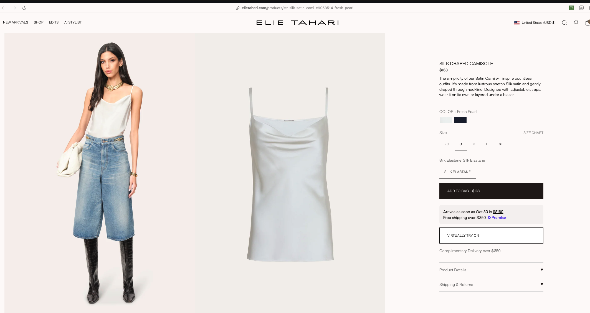
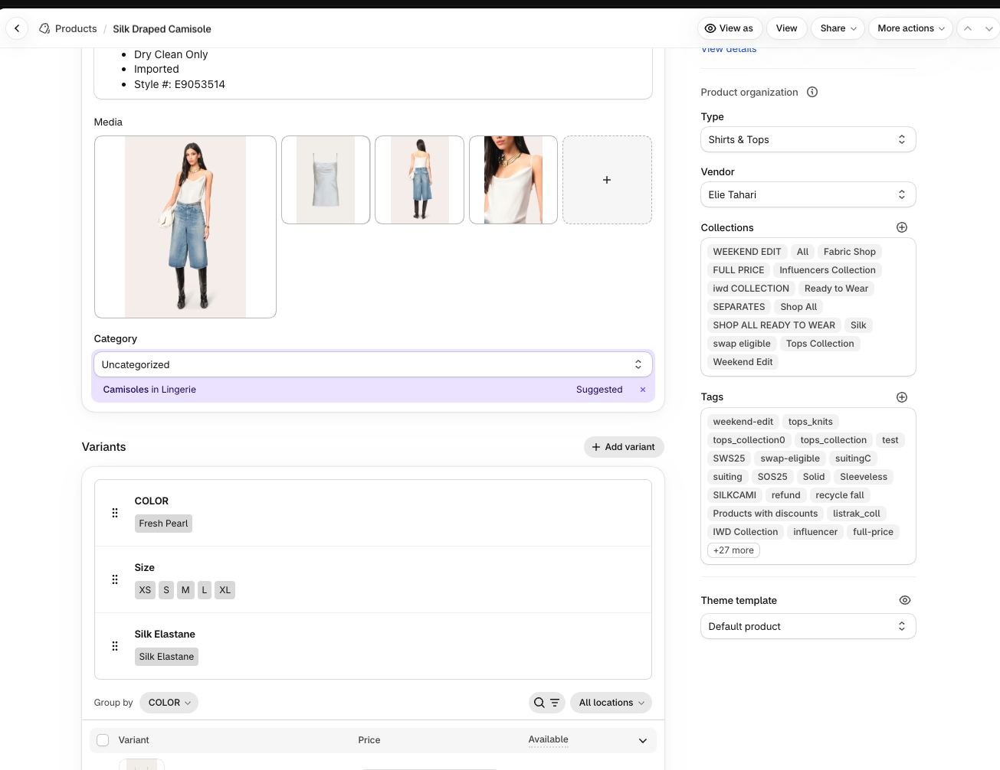

## Background:

- Client QA feedback on popups and the Quick Add drawer: remove rounded corners, fix Size Chart styling, add toggles for the Full Details link and color options, and add Buy Now next to Add to Bag.
- The Quick Add drawer must match the new PDP (TAHARI-12170552235) Add to Bag and Buy Now buttons.

## Necessary Info (Design/Documentation):

|  Popups & Modals |  Remove rounded corners on popups; Size Chart lowercase & underlined |
| --- | --- |
|  Quick Add Drawer |  Carousel bag icon click opens Quick View modal with 'Full Details' link ( make it a setting to remove) |
|  Quick Add Drawer |  Not sure the color change is necessary here as you just leave the quick add to cart ( make it a setting to remove the color variants) |
|  Quick Add Drawer |  Add Buy Now button next to Add to Cart in Quick Add Drawer |
|  Quick Add Drawer |  "Size Chart" shouldn't be in all caps. it should be underlined like every other button. |

- Figma: https://www.figma.com/design/iBHKtwieSkMfWqYalNhK1v/Elie-Tahari---Amar-Copy
- No Quick Add drawer mockup exists. Visual reference is the new PDP desktop form (the buy box over the gallery).
- Buy Now behavior decision: vault `02-decisions/decisions.md`, 2026-07-20 "PDP Buy Now".
- Catalog at authoring: 441 of 445 published products have a single-value Color option, with other colors linked as separate products via `custom.available_colors`. 3 have a multi-value Color option.
- Sold-out swatch slash logic: PDP UAT part 2 row 40 (13116959310). Slash when a color is sold out in every size, shown on every sibling's PDP.
- Live drawer, sold-out variant: Sold Out (outline, disabled) and Notify Me (solid). Notify Me reveals the email field inline. No Shopify payment buttons.

## Constraints / Scope:

- Branch from `develop/_candidate`. The new PDP and the drawer share snippets there.
- Built as a separate drawer version (v2) behind an RS: Quick view setting. The current drawer (v1) stays as live.
- The drawer matches the new PDP desktop form visually at every breakpoint. It does not adopt the PDP's mobile triggers, bottom sheets, or sold-out crossfade.
- Sold-out behavior matches live (Notify Me reveals the email field inline), restyled to the PDP buttons.
- Buy Now uses the PDP's custom add-to-bag-then-checkout behavior. Shopify dynamic checkout and accelerated payment buttons are not shown in the drawer.
- Prior work on this ticket (PRs #114, #126, #127) was built and merged on `release/_candidate`, against the old PDP. Reuse what holds up, replace what doesn't (see Dev Notes).
- Legacy PDP (`sections/product.liquid`) is out of scope. It is replaced at redesign cutover.

## Objective/Acceptance Criteria:

### Quick add drawer

Items 1 to 18 are the ticket scope. 19 onward were added during the work; "also PDP" items use shared code, so check them in the drawer and on the PDP.

| # | Item | Notes | Dev | QA |
| --- | --- | --- | --- | --- |
| 1 | On mobile (≤749px) the Quick Add drawer has square corners (no border radius). |  | ✅ |  |
| 2 | The drawer variant picker matches the new PDP desktop form: color chips, boxed size grid, and a "Size Chart" link in the label position, in sentence case and underlined. |  | ✅ |  |
| 3 | With RS: Quick view "Show Full Details link" on, the drawer shows a "Full Details" link to the product page. Off, the link is not rendered. |  | ✅ |  |
| 4 | With RS: Quick view "Show color options" off, the drawer hides the swatches that link to other color products. The product's own color label and swatch stay visible. | https://www.elietahari.com/search?options%5Bprefix%5D=last&q=Silk+Satin+Sleeveless+Ruffle+Top : quick add Silk Draped Top shows only its own color; its other colors appear on the PDP. | ✅ |  |
| 5 | With "Show color options" off, a product with several colors of its own still shows all of them. Size options are unaffected. | https://www.elietahari.com/search?options%5Bprefix%5D=last&q=Silk+Satin+Sleeveless+Ruffle+Top : quick add Silk Satin Sleeveless Ruffle Top shows 2 colors (Black, Sangria), its own color variants. | ✅ |  |
| 6 | Color swatches show the PDP sold-out slash (UAT row 40): a sibling color sold out in every size is crossed out, and the product's own swatch is crossed out when it is sold out in every size. A color with any size in stock has no slash. |  | ✅ |  |
| 7 | Add to Bag (outline) and Buy Now (solid, with price) match the new PDP desktop buy box (88px squares) at every breakpoint. |  | ✅ |  |
| 8 | Below 750px the drawer keeps the PDP desktop form presentation. No mobile triggers and no bottom sheets open inside the drawer. |  | ✅ |  |
| 9 | No Shopify dynamic checkout or accelerated payment buttons render in the drawer. |  | ✅ |  |
| 10 | Buy Now adds the selected variant to the bag without removing existing items, then goes to checkout with all bag items. |  | ✅ |  |
| 11 | Changing size or color in the drawer updates price, button state, and media in place. |  | ✅ |  |
| 12 | Buy Now is disabled when the selected variant is sold out. |  | ✅ |  |
| 13 | For a sold-out variant, the drawer shows Sold Out and Notify Me styled like the PDP. Notify Me reveals the email field inline in the drawer. |  | ✅ |  |
| 14 | Add to Bag and Buy Now in the drawer have no hover shading and no checkmark animation. The loading spinner remains. |  | ✅ |  |
| 15 | If Buy Now fails (e.g. inventory limit), the error shows in the drawer error area and the button becomes clickable again. |  | ✅ | Test: add [Uma Structured Wool Coat XS](https://www.elietahari.com/products/uma-strutured-coat-in-camel?variant=48346422902921) to the bag, then Buy Now again. Also PDP and mobile sticky bar. |
| 16 | Returning from checkout via browser back does not leave Buy Now stuck loading. |  | ✅ |  |
| 17 | With RS: Quick view "Use quick add v2" off, the drawer renders the current live version (v1) unchanged. |  | ✅ |  |
| 18 | New PDP buy box, sticky bars, variant picker, and Buy Now behavior are unchanged. |  | ✅ |  |
| 19 | (Added) Quick add drawer: on tall viewports the image area hugs the photo, with no empty space below it. |  | ✅ |  |
| 20 | (Added) Quick add drawer: Add to Bag / Buy Now and the quick view text ("Complimentary Delivery over $350") sit together at the drawer bottom and stay pinned while scrolling, as on the v1 drawer; the text is never covered. |  | ✅ |  |
| 21 | (Added) Quick add drawer: the quick view text renders under the buttons in v2, at the same size as the PDP delivery text block. |  | ✅ |  |
| 22 | (Added) Quick add drawer: on Notify Me success the email field and buttons hide and only the success message shows, matching the PDP; an invalid email shows the PDP error styling. |  | ✅ |  |
| 23 | (Added) PushOwl's toast sits behind the quick add drawer (and other scroll-locked drawers) instead of covering it on mobile. |  | ✅ |  |
| 24 | (Added, also PDP) Buy Now in the drawer only reacts to the drawer's own product (a variant change on the PDP behind it does not change it, and vice versa), and its price updates on variant change. |  | ✅ |  |
| 25 | (Added, also PDP) Add to Bag, Buy Now and Notify Me in the drawer have no hover shading (UAT row 41 fix to the shared buy box styles). |  | ✅ |  |
| 26 | (Added, also PDP) Text options other than Size (e.g. "Silk Elastane") show in an equal-width grid (3 columns, 6px gap, each box as wide as the widest value) in the drawer; Size squares and color swatches are unchanged. | https://www.elietahari.com/products/str-silk-satin-cami-e9053514-fresh-pearl | ✅ |  |

### Main PDP (added during the work, TAHARI-13230460741)

Not in this ticket's original scope; recorded here as work done alongside it. "Also quick add" items use shared code: check them in the drawer too (see the quick add table).

| # | Item | Notes | Dev | QA |
| --- | --- | --- | --- | --- |
| P1 | A variant change in one product does not change the other's Buy Now (e.g. drawer open over a PDP), and the Buy Now price updates on variant change. (also quick add) |  | ✅ |  |
| P2 | Buy Now and Notify Me have no hover shading on the buy box, sticky bars and quick add (UAT row 41 was not applied to solid buttons). (also quick add) |  | ✅ |  |
| P3 | Mobile: size/color option label text aligns with the buy button text in the main form and the mobile sticky bar. |  | ✅ |  |
| P4 | Mobile: the Color trigger in the main form is tappable (the buy buttons no longer cover it). |  | ✅ |  |
| P5 | Desktop: the main gallery shows no blank slide on wide screens (above 1440px), including while scrolling. |  | ✅ |  |
| P6 | Accordion blocks have a desktop column setting (Left/Right); consecutive accordions in a column open one at a time, and their margin/padding settings apply. |  | ✅ |  |
| P7 | Text block has a "Text custom (Liquid)" field for metafields whose values contain HTML (tags or entities like nbsp); it renders below Text. |  | ✅ |  |
| P8 | Desktop: the first rich text paragraph at the top of a column has no extra top margin, so column tops follow the block margin settings. |  | ✅ |  |
| P9 | Desktop: text options other than Size (e.g. gift card amount) show in an equal-width grid (3 columns, 6px gap, each box as wide as the widest value) instead of the size squares; Size and color swatches are unchanged. (also quick add) | https://www.elietahari.com/products/gift-card | ✅ |  |
| P10 | Mobile: options other than Size and Color (e.g. gift card amount) have a trigger and drawer panel in the main form and the mobile sticky bar, with equal-width values. | https://www.elietahari.com/products/gift-card | ✅ |  |
| P11 | Mobile: with 3 or more option triggers, triggers wrap two per row in the main form and the mobile sticky bar (the sticky bar grows to fit). |  | ✅ |  |

## Dev Notes:

File paths, line numbers, and code below reflect a review at authoring time. Confirm they still hold before implementing.

**How the drawer renders**
- Shell: `snippets/product-quick-add-modal-template.liquid` (`<template data-quick-add-modal-template>`).
- Content: `QuickAddProduct.renderModal()` (`assets/theme.dev.js` ~6584) fetches `/products/{handle}?section_id=api-product-upsell`.
- `modalCreate()` (~6356) copies only `[data-api-content]` via `innerHTML`. Injected `<script>` tags do not run. Stylesheet `<link>` tags inside `[data-api-content]` do load.
- `product-info.js` updates the drawer on variant change by section id (`#product-form-{section}`, `#ProductSubmitButton-{section}`, `#Preorder-{section}`, `[data-form-wrapper]`). The PDP buy box uses the same contracts.

**Approach: v2 section reusing the PDP form snippets**

| Piece | Change |
| --- | --- |
| `sections/api-product-upsell-v2.liquid` | New. v1 layout (images + form), form renders the PDP snippets with `quick_add: true` |
| `assets/quick-add-v2.css` | New. Drawer-only overrides: keep desktop form presentation below 750px |
| `config/settings_schema.json` | New `quickview_use_v2` checkbox (default on) in RS: Quick view |
| `snippets/head.liquid` ~812 | Add `quickAddSection` to `window.theme.settings` |
| `assets/theme.dev.js` ~6584 | `section_id=${window.theme.settings.quickAddSection \|\| 'api-product-upsell'}` |
| `snippets/main-product-variant-picker.liquid` | `quick_add` param skips mobile triggers, drawer templates, mobile size chart popup, script. Passes the color toggle through |
| `snippets/main-product-buy-buttons.liquid` | `quick_add` param skips the `<buy-box-drawer>` dialog and templates. Sold out renders the inline `<klaviyo-bis-form>` (live behavior) |
| `layout/theme.liquid` | Load `buy-now-button.js` when `settings.quickview_enable` (scripts in the drawer don't execute) |

- The PDP never passes `quick_add`, so its output is unchanged.
- Desktop form styles come from `assets/main-product.css` and `assets/main-product-buy-buttons.css` (`.main-product-variant-picker`, `.buy-box-actions`). Load both in v2.
- Below 750px `main-product.css` hides `.main-product-variant-picker__desktop-grid` and `main-product-buy-buttons.css` stretches the buttons. Override both in `quick-add-v2.css`.
- `main-product-buy-buttons.css` already removes hover (row 41) and checkmark (row 42) under `.buy-box-actions`.
- `ProductForm.onSubmitHandler` already skips submits from `<buy-now-button>` (`theme.dev.js`, TAHARI-12551877753 guard).
- Back-button spinner (AC 16): add a `pageshow` (`event.persisted`) reset in `buy-now-button.js` if the PDP has the same issue.

**Color toggle (AC 4, 5)**
- Links to other color products are the `custom.available_colors` block in `snippets/product-variant-options.liquid` (~163), rendered from the swatch branch of `product-variant-picker.liquid`. Skip only that block when the toggle is off.

**Size Chart (AC 2)**
- Row 45 (`product-variant-picker.liquid` ~345) replaces the Size label with the Size Chart link for every caller. Its position fix is in `main-product.css`, which v2 loads. v1 and the legacy PDP still show it right-aligned (out of scope).

**Prior work on `release/_candidate` (merge base `eabe31c`, PRs #114/#126/#127)**

| Change | Action |
| --- | --- |
| Mobile drawer `border-radius: 0` (`theme.css`) | Dropped in merge. Identical change already on `develop/_candidate` |
| `.size-chart-link` class, uppercase removed | Dropped in merge. Covered by row 45 classes |
| `quickview_show_full_details` + gate in `snippets/product-description.liquid` | Kept. Gate is inside the `product_api` branch, drawer only |
| `quickview_show_variants` hides the whole picker | Renamed to `quickview_show_color`, color only, v2 only. v1 wrap reverted |
| `.product-quick-add .is-added` checkmark override | Reverted. v2 inherits the PDP rule |
| Buy Now: hidden `payment_button` + dummy button proxying "More payment options" | Reverted. Single-item checkout ignored the bag and loaded the Shop Pay SDK per open |
| Two-column grid, solid ATC with price, outline Buy Now | Reverted. v2 inherits PDP styles |

## Implementation Notes:

- `sections/api-product-upsell-v2.liquid` (new): v1 image layout; form renders `product-variant-picker` in the PDP's `.main-product-variant-picker__desktop-grid` wrapper and `main-product-buy-buttons` with `quick_add: true`.
- `assets/quick-add-v2.css` (new): block spacing copied from the PDP form's block settings (badges 4, price 3/10, variant picker 20, title 16px); desktop form rules restated below 750px; underlined Notify Me email field.
- Settings (RS: Quick view): `quickview_use_v2` (new, default on), `quickview_show_color` (renamed from `quickview_show_variants`, v2 only), `quickview_show_full_details` (kept).
- `snippets/head.liquid`: `window.theme.settings.quickAddSection`; loads `buy-now-button.js` when v2 is on. `theme.dev.js`: `renderModal()` fetches that section.
- `snippets/product-variant-picker.liquid` / `product-variant-options.liquid`: `hide_related_colors` param (v2 only) skips the `custom.available_colors` links. The product's own color option is untouched.
- Sold-out slash (AC 6) needs no drawer code: `product-variant-options.liquid` adds `sibling__link--sold-out` / `visually-disabled`, and the slash CSS in `main-product.css` is scoped to `.main-product-variant-picker`, which v2 wraps the picker in.
- `snippets/main-product-buy-buttons.liquid`: `quick_add` param skips `<buy-box-drawer>` and its templates/scripts; sold out renders an inline `<klaviyo-bis-form>` (live behavior).
- `assets/buy-now-button.js` (shared with PDP): ignores `variantChange` from other products (a sold-out pick in the drawer was disabling the PDP's Buy Now); updates its own price line on variant change (it was never updated on the PDP either); resets loading on bfcache `pageshow`.
- `assets/main-product-buy-buttons.js` (shared with PDP): `is-updating` fade scoped to the changed product.
- Drawer layout (`quick-add-v2.css`): image row hugs the photo (`grid-template-rows: auto 1fr`, `min-height: 100%`) so tall viewports leave no gap under it. Buttons sit in normal flow, 32px under Full Details (the live sticky, bottom-pinned row was tried and dropped: the 88px squares looked stranded at the drawer bottom).
- RS: Quick view "Text" (`quickview_text`, e.g. "Complimentary Delivery over $350") renders under the buttons in v2, same markup as v1 (`.product-quick-add__form__text`).
- `assets/theme.css`: PushOwl toast drops behind the overlay while scroll is locked (`body[data-scroll-lock-locked]`), so it no longer covers the quick add drawer on mobile.
- v1 restored to `develop/_candidate` (prior Buy Now proxy, checkmark override, inline grid, and variant picker wrap reverted).
- Vault: `patterns/quick-add-v2.md`, decisions 2026-10-26.

**Related PDP fixes (TAHARI-13230460741), also used by quick add v2**

- Text options other than Size (e.g. gift card "Style", "Silk Elastane"), desktop form:
  - `snippets/product-variant-picker.liquid`: the button branch adds `radio__fieldset--default` to the fieldset when the option is not Size, a swatch, or an image option.
  - `assets/main-product.css`: `--default` values sit in a 3-column `inline-grid` of `1fr` columns (each as wide as the widest value), 6px gap, `height: auto`, `padding: 6px 0`, instead of the 45px Size squares. Size and color swatches are unchanged.
  - Showing the selected value only for Color (e.g. "Style" instead of "Style $500.00 Usd") was tried and left as is; possible paid enhancement if the client wants it.
  - Example: https://www.elietahari.com/products/gift-card?variant=44988098347145
- Mobile (`d9702ad`): options other than Size/Color get a trigger and drawer panel (`snippets/main-product-option-triggers.liquid`, shared by the main form and mobile sticky bar). Panel values share the widest value's width (2-column grid). With 3+ triggers the row wraps two per row and the mobile sticky bar grows to 214px (`--mobile-sticky-bar-height`, which the footer reservation and PushOwl offset also read).

## Testing Notes:

- Test pages (dev theme, keep `preview_theme_id`): PDP with quick add cards and sold-out sizes `/collections/elie-tahari-sale/products/linen-bermuda-short-e505k216-fresh-pearl`; collection `/collections/elie-tahari-sale`. Card with sold-out sizes: Linda Linen Foldover Top (XS, S sold out). Multi-color product: `s-l-slk-ruffle-shirt-er053504-black`.
- Compare the drawer against the PDP form on the same page at 1440.
- Buy Now: add any item first, then Buy Now from the drawer; checkout must list both.
- Sold out: pick XS in the drawer; Sold Out + Notify Me show; Notify Me opens the email field (don't submit on prod).
- Open the drawer over a PDP, pick a sold-out size in the drawer; the PDP's Buy Now must stay enabled.
- Sold-out slash: on `/products/products-skylar-milano-pencil-skirt-dusty-rose`, Curated for you, quick add Blair Milano Sculpt Peplum Top. Ice Blue is crossed out; Dusty Rose, Black, Blanco are not. Own-swatch case: `blair-sculpted-knit-ice-blue` (sold out in every size) crosses out its own swatch. Compare with the PDP `/products/products-blair-milano-sculpt-peplum-top-dusty-rose`.
- Variant image swap (AC 11): search "silk draped camisole", quick add `str-silk-satin-cami-eu05350u-mulberry`, pick Pacific Blue then Mulberry. The image switches to Mulberry's variant image in place (Pacific Blue has none, so it keeps the current image).
- Toggles: "Show color options" off (Chloe Charmeuse Blouse from Curated for you: own Canvas Clay swatch stays, sibling swatch hides), "Show Full Details link" off, "Use quick add v2" off (v1 drawer, no Buy Now).
- Widths: 375, 480, 749, 750, 768, 989, 990, 1440.

## Bugs from QA:

TBD

## Clarifying Questions:

### Product data and options (reviewed with the MP, 2026-10-27)

**1. Products with multiple color variants and linked color products**
- Issue: 3 of 445 products have more than one color as variants on the same product, and some also link separate color products through `custom.available_colors`. On the Cash-Wool Sweater, Snow is both a variant and a linked product, so Snow shows twice.
- Why it's a problem: the PDP, quick add and mobile color drawer were built on one color per product, which the client confirmed earlier (no products with multiple color options; per the cart image ticket TAHARI-ISSUE-12293839539, "each color is its own product" and "variants are sizes only"). Mixed setups produce duplicate colors and behavior nobody has defined, especially when a variant and a linked product share a color value.
- Decision: let the client know these products don't follow the agreed setup. Supporting multiple colors plus linked colors (including the same color value) needs requirements and expected behavior scoped as separate work.
- Products:
  - Cash-Wool Sweater: Black https://www.elietahari.com/products/ss-turtleneck-swtr-er54x504-black (admin https://admin.shopify.com/store/elie-tahari/products/7546337165449), linked Snow https://www.elietahari.com/products/ss-turtleneck-swtr-er54x504-snow, linked Midnight https://www.elietahari.com/products/ss-turtleneck-swtr-er54x504-midnight
  - Silk Satin Sleeveless Ruffle Top (Black, Sangria): https://www.elietahari.com/products/s-l-slk-ruffle-shirt-er053504-black?variant=46942012440713 (admin https://admin.shopify.com/store/elie-tahari/products/7517926031497)
  - Silk Draped Camisole, Mulberry (Mulberry, Pacific Blue, linked Stargazer): https://www.elietahari.com/products/str-silk-satin-cami-eu05350u-mulberry (admin https://admin.shopify.com/store/elie-tahari/products/8233262448777)

**2. Color variants without their own images**
- Issue: when a color variant has no images of its own, choosing it keeps the other color's images (Ruffle Top Sangria shows black photos, Camisole Pacific Blue shows Mulberry). On the Ruffle Top, a separate Sangria product with images exists but is not published to the Online Store.
- Why it's a problem: the shopper picks a color and sees a different one, especially on mobile where the color drawer shows an image per color.
- Decision: part of item 1; include in the client conversation and the scoping.

**3. Flat lay (ghost) image per color**
- Issue: the mobile color drawer shows the image with alt text `alt:ghost` (any position), else the product's 2nd image, else the variant image. That is one image per product, so every color variant on a product shows the same flat lay (for example a black top labelled Ruby).
- Why it's a problem: the variant image cannot be repurposed for the flat lay. It is the client's no-dev way to get the model image into checkout (cart image ticket TAHARI-ISSUE-12293839539), so using it for flat lays would conflict.
- Decision: a per-color flat lay needs a different way for the client to specify it (for example a naming rule or a metafield). Part of the item 1 scoping.

**4. Products with more than 2 options**
- Issue: Silk Draped Camisole (Fresh Pearl) has a third option, "Silk Elastane", with a single value, so it shows "Silk Elastane Silk Elastane" and a one-button picker (also on live).
- Why it's a problem: 3 options were never mocked up or discussed, and the client said earlier there are no products with more than 2 options.
- Decision: display as built for now (desktop equal-width grid; mobile triggers wrap two per row and the sticky bar grows). Behavior for 3+ options on the new mobile design needs requirements if the client wants it supported.
- Product: https://www.elietahari.com/products/str-silk-satin-cami-e9053514-fresh-pearl (admin https://admin.shopify.com/store/elie-tahari/products/7481596674185)
  - Live PDP: 
  - Admin options: 

**5. Gift card amount labels**
- Issue: amounts read "$50.00 Usd" and stay in USD outside the US while the price converts.
- Why it's a problem: minor; the labels look unpolished.
- Decision: keep matching live. Existing behavior that was not defined to change.
- Product: https://www.elietahari.com/products/gift-card

### Other

- Prior work (PRs #114/#126/#127) is reverted on `release/_candidate` by PR #135 (`71c144c`, `1f30db7`, `d4d8bed`). Before this ticket merges into `release/_candidate`, revert those three commits there first (vault decisions 2026-10-29).
